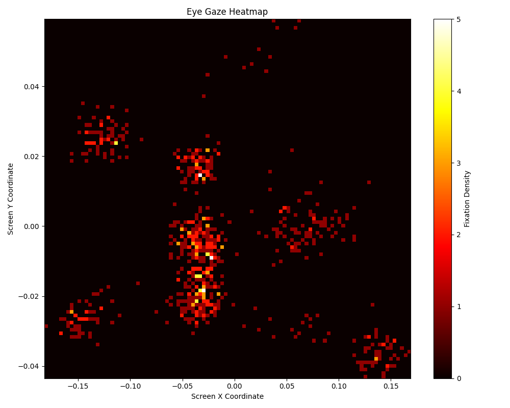
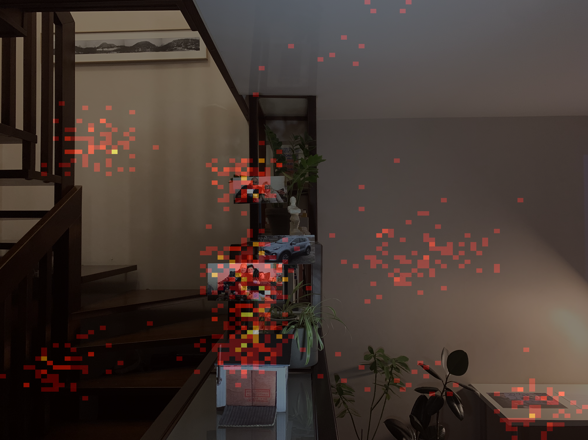

# Webcam Eye-Tracking Prototype — Gaze Heatmaps for Visual Saliency Research

A web-based eye-tracking instrument that uses a laptop webcam as a gaze-recording device. The system calibrates the user against a **3 × 3 grid of nine on-screen targets**, records normalised iris position while the user views a stimulus image, and renders the recorded gaze samples as a **density heatmap overlaid on that image**. No specialist hardware is required — the pipeline runs on a standard webcam feed and a Python backend.

The instrument is scoped as a *measurement* tool, not an interpretation tool: it records where gaze samples fall and visualises their distribution. It does **not** classify fixations and saccades, and it makes no claim about why a viewer looked anywhere. 

Five JPEG stimulus images are **built into the application** at `app/static/images/`. The current set is a mixed collection from the Wartime Art Archive ([website](https://waa.umca.art/en)), namely the documentary wartime photography and urban scenes, used to exercise the pipeline.

Built with Python, Flask and MediaPipe Face Mesh. Developed as the measurement front-end of an independent research project on cultural bias in AI saliency models.

## Role within the wider research project — Cultural Bias in AI Saliency Models

Research Question:

> **Do computer-vision saliency models overlook Ukrainian national and military symbols in wartime art?**
 
Saliency models predict which regions of an image attract human attention. Existing models may not fully account for culturally specific visual elements, particularly symbols of cultural and historical significance to the viewer. If a model's predicted attention map systematically diverges from where viewers actually look, particularly around national and military symbols, it can indicate a measurable form of cultural bias.

| Research stage | What is required | Status |
|---|---|---|
| **1. Human gaze tracking** | A recording instrument producing per-image gaze distributions from human viewers | **This repository** (working prototype) |
| **2. Model saliency maps** | Predicted attention maps for the same images from existing saliency models | Planned |
| **3. Divergence analysis** | Comparison of human gaze distributions against model predictions, with attention to regions containing national and military symbols | Planned |
| **4. Targeted retraining** | Test whether training on Wartime Art Archive artworks improves symbol recognition | Planned |

Research scope considerations:

- **The AI is not being asked to judge art.** The model is not used to evaluate artistic merit. The model's output 0is a *saliency prediction*: a map of predicted visual attention. The comparison is between predicted attention and measured human attention.
- **Instrument built for the research question.** Existing publicly available gaze datasets may not adequately represent the Ukrainian wartime artworks examined in this research, making it necessary to collect viewing data directly for the selected images. This eye-tracker measures that baseline data on a stimulus set drawn from Wartime Art Archive artworks.

## Functionality

### Stage 1 — Calibration

The browser requests webcam access at **1280 × 720**, draws each frame to a hidden canvas, encodes it in a JPEG format and sends a POST request to the backend every **250 ms**.

| Step | What happens |
|---|---|
| 1 | A target dot is drawn at one of nine screen positions (`TOP_LEFT` → `BOTTOM_RIGHT`) |
| 2 | Each uploaded frame is decoded with OpenCV and passed to **MediaPipe Face Mesh** (`max_num_faces=1`, `refine_landmarks=True` to enable the iris landmark set) |
| 3 | Iris centre per eye = mean of four iris landmarks (left `474–477`, right `469–472`) |
| 4 | Each iris centre is expressed relative to the eye centre (midpoint of the inner/outer canthus landmarks — left `133`/`33`, right `263`/`362`) and divided by eye width, giving a scale-normalised vector; the X axis is flipped so X increases left-to-right |
| 5 | Left and right normalised vectors are averaged into a single gaze vector per frame |
| 6 | **20 frames** are accumulated per target; the frontend displays a live `Frames Captured: n/20` counter, and a **Next** button skips to the following target |
| 7 | On completion, a mean vector is computed for each of the nine targets, and the global mean across those nine means (`mean_center`) is stored as the session's centring offset |

A face-detection guard is applied during calibration: frames in which no face is detected are discarded rather than counted.

### Stage 2 — Eye tracking

The user selects a stimulus image from the sidebar and presses **Start Eye Tracking**. The browser captures and sends POST requests with frames every **500 ms**.

Each frame produces one gaze sample through the identical normalisation path used in calibration, with the session's `mean_center` subtracted. Samples are appended to a per-session, per-image list under a `threading.Lock`, structured as:

```
gaze_store[session_id]['gaze_results'][image_name] → [{'frame': n, 'norm_x': x, 'norm_y': y}, …]
```

A polling script tracks elapsed time against the configured recording window and redirects to the results page when the window closes.

### Stage 3 — Results

The backend builds a **100 × 100 bin 2-D histogram** of the recorded samples, renders it with the matplotlib `hot` colormap at `alpha=0.5` over the stimulus image. The sidebar lists every image already processed in the session, so a participant can record several stimuli and compare heatmaps without re-calibrating.

Session isolation is handled by a UUID stored in the Flask session, with per-session state held in in-process dictionaries.

## Results produced so far

### 1 — Gaze sample density in normalised coordinates



This figure plots recorded gaze samples in the prototype's own normalised coordinate space, before any overlay:

- **The signal carries real structure.** The samples resolve into roughly seven distinct high-density clusters separated by near-empty space.

### 2 — Heatmap overlaid on a stimulus image



The same density data rendered over the stimulus the user viewed:

- **Useful results:** the densest clusters fall on the vertical column of framed photographs and the objects on the shelf — the regions with faces and semantic content. This will later be used for saliency-prediction comparison.
- **Limitations:** a portion of the density falls on featureless wall surface carrying no visual or semantic detail. The primary limitation: **the coordinate mapping is not yet calibrated to absolute screen position**, placing the clusters by relative distribution rather than absolute screen location.

## Testing

This release runs locally and is driven by a small set of built-in stimulus images taken from the Wartime Art Archive; there is no deployed instance and no upload route.

**Prerequisites:** Python 3.12, a working webcam, and a browser that grants camera access to `localhost`.

**Steps:**

1. Create and activate a virtual environment, then `pip install -r requirements.txt`.
2. Create a `.env` file at the repository root containing `SECRET_KEY`, `DEBUG`, `PORT` and `FLASK_APP`.
3. Run `python main.py` and open the printed local address.
4. On the homepage press **Begin Session**. Press **(Re)Start** on the calibration page and grant camera access when prompted.
5. Fixate each of the nine target dots in turn until the counter reaches `20/20`, or press **Next** to advance early. Sit at a fixed distance with the head still.
6. When the page reports **Calibration complete!**, press **Eye Tracking Page**.
7. Select a stimulus image from the sidebar, press **Start Eye Tracking**, and view the image for the recording window. The page redirects to the results heatmap automatically.
8. Repeat step 7 for further images; previously processed images stay available in the results sidebar.

> **Calibration is per-session and non-persistent.** Pressing **Reset Session**, restarting the server, or opening the app in a new tab clears all calibration and gaze data.

## Repository layout

```
main.py                          Application entry point
requirements.txt                 Pinned dependencies
app/
  __init__.py                    Flask app factory, config loading, error handlers
  config.py                      SECRET_KEY, DEBUG, PORT from environment
  routes.py                      All routes: calibration, frame intake, tracking, results
  utils.py                       Session IDs, in-memory gaze store, frame counters, thread lock
  scripts/
    settings.py                  MediaPipe Face Mesh config, target grid, frame budgets, iris landmark indices
    calculations.py              Iris centre computation and eye-width normalisation
    calibration.py               Per-target frame accumulation, per-target means, mean_center
    eye_tracker.py               Per-frame gaze sample extraction during recording
    visuals.py                   2-D histogram heatmap rendered over the stimulus image
  templates/                     Homepage, calibration, eye-tracking and results pages
  static/
    css_files/                   Page styling
    js_scripts/                  Calibration target placement; results polling
    images/                      Built-in stimulus images (1-5)
data_files/results/              Heatmap figures
```

## Tech stack

Python 3.12 · Flask · MediaPipe Face Mesh (iris refinement) · OpenCV · NumPy · SciPy · matplotlib (Agg) · Pillow · Gunicorn · python-dotenv · HTML/CSS/JavaScript (`getUserMedia`, canvas frame capture)

## Scope and limitations

**Gaze tracking**

- **Gaze is recorded in relative, not absolute, image coordinates.** Gaze signal from the user webcam is noisy and drift-prone, making the current build produce *relative* gaze distributions rather than *absolute* screen positions. Calibration stores a mean vector per target, but the tracking path consumes only the global offset `mean_center`. No polynomial mapping to screen pixels is fitted. Heatmap renderer then stretches each sample cloud min–max to fill the stimulus image. Saliency metrics require the human gaze map registered to the same pixel grid as the model's prediction.
- **No account for measurement error.** No angular accuracy has been measured. The build has no blink, outlier rejection or fixation classification.

**Data and deployment**

- **Temporary live data.** Gaze samples, calibration results and cached heatmaps are not written to a database, causing a loss of data on restart.
- **No raw-data export.** There is no CSV or JSON export route for recorded gaze samples — the only output is the rendered heatmap PNG. Export is a prerequisite for later model-comparison stages of the research project.
- **Narrow stimulus set.** Five built-in images, no upload route, and no stimulus metadata. A saliency-divergence analysis will require a larger stimulus sample size.

**Research framing**

- The outputs so far are **human gaze measurements only**. No saliency model has been run, no human-versus-model comparison has been performed, and no claim about cultural bias in any model is made or supported by this system. These are planned for the project's next stages.
- Recordings to date are from a single user test, and the stimulus set is not matched for medium or symbol content. A claim about how viewers attend to national and military symbols in Ukrainian art requires multiple participants and a controlled stimulus set, neither of which the prototype at this stage provides.
